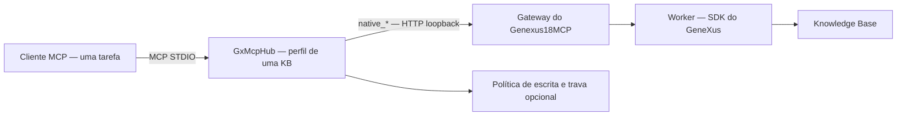

# Arquitetura do GxMcpHub



Cada tarefa ou sessão do cliente inicia **um Hub** com **um perfil**. Vários Hubs (sessões, scripts, tarefas agendadas) podem falar com o **mesmo Gateway**; o que o Hub decide sozinho é quem inicia, mantém e encerra esse Gateway. O backend ativo é sempre `kind: fixed`, por HTTP, e o Hub não conhece o SDK: o que ele conhece do backend é o `tools/list`, o `readOnlyHint` de cada ferramenta e o endpoint.

## Inicialização

1. Carrega e valida o perfil (a KB precisa existir; `writePolicy.mode` é `read-only`, `single-writer` ou `open-writer`).
2. Em `single-writer`, adquire uma trava exclusiva pelo caminho normalizado da KB (`WriterLease`).
3. Coordena o início da porta entre processos (uma trava de início por endpoint).
4. Inicia o Gateway pelo `startup` do perfil **somente quando o endpoint ainda não está ouvindo**.
5. Faz o handshake MCP, descobre as ferramentas e as prefixa com `toolPrefix` (padrão `native_`).
6. Aplica a classificação e a política também na chamada genérica `gxhub_call`.
7. Ao encerrar, só mexe no que iniciou (ver "Gateway compartilhado e presença").

Uma sessão HTTP expirada é renovada **uma vez**, depois de um erro explícito. Timeout ou transporte ambíguo **não é repetido**: repetir poderia duplicar uma chamada que escreve.

## Política de escrita

| Modo | Efeito |
|---|---|
| `read-only` | Só as ferramentas classificadas como leitura (anotação `readOnlyHint` do catálogo, ou `readOnlyTools` do perfil). Ferramenta sem classificação conta como escrita. |
| `single-writer` | No máximo uma instância escritora por perfil e KB: trava exclusiva entre processos. |
| `open-writer` | Sem trava. Várias instâncias podem ler e gravar ao mesmo tempo: **não protege contra gravação concorrente** nem detecta conflito semântico. |

Com `hideBlockedTools` (padrão), o que a política bloqueia some do `tools/list`; a chamada genérica `gxhub_call` repete a mesma política e é anunciada ao cliente de forma conservadora (`readOnlyHint: false`, `destructiveHint: true`).

## Reconciliação e início sob demanda

Depois de iniciado, o Hub mantém o perfil e a conexão com o backend em dia, sem ação da sessão:

1. Uma rodada a cada 10 segundos, e antes de cada chamada de ferramenta, compara o JSON do perfil com o carregado e o processo que escuta o endpoint com o anotado na conexão.
2. Um perfil alterado e compatível (mesmo nome, workspace, KB e política de escrita) é recarregado em memória quando a mudança está toda dentro de `backends[].startup` e não exige parar um Gateway deste Hub. Com esse Gateway em execução, ou com mudança em qualquer outro campo, a recarga espera um `gxhub_refresh`. A revisão do perfil é o SHA-256 dos bytes carregados.
3. Gateway substituído leva a uma nova conexão e a uma lista de ferramentas nova; Gateway encerrado deixa o backend offline. Nenhum dos dois inicia processo.
4. Só uma chamada que precise de um backend offline inicia o Gateway, pelo perfil carregado e sob a trava de início, e a chamada é despachada **uma única vez**. Se o início falha, a chamada e o `gxhub_refresh` recebem um código fixo (`backend-start-timeout`, `backend-start-failed`, `backend-start-busy`); o texto da exceção, que traz caminhos, fica no stderr do Hub.
5. A rodada periódica nunca espera atrás de uma chamada em curso: com o Hub ocupado ela é pulada, e a chamada seguinte reconcilia antes de ser despachada.

Todo início de backend (início do Hub, `gxhub_refresh`, chamada com backend offline) passa por **um único ponto de decisão**, alcançado só quando ninguém escuta o endpoint. Ali o Hub recusa iniciar enquanto houver uma **implantação em andamento** (o arquivo `<workspaceRoot>\GxMcpHub\runtime\promotion.lock` aberto, sem compartilhamento, por quem implanta) e enquanto o perfil em disco não for o carregado; espera a implantação terminar (nunca no início do Hub), recarrega o perfil e pergunta de novo. Assim um backend nunca sobe pelo pacote antigo de um perfil que a implantação acabou de reescrever.

O processo que escuta a porta é identificado pela tabela TCP do sistema (PID e instante de criação), sem conexão nem tráfego MCP. "Gateway deste Hub" é o processo que escuta quando ele é o que o Hub iniciou **ou um descendente dele** (um perfil que inicia o Gateway por um script). Um processo deste Hub que está vivo enquanto outro, fora da árvore dele, é o dono da porta não é o Gateway: é encerrado e o backend passa a ser tratado como de outro lançador. Um processo deste Hub que estoura o prazo de início sem ninguém escutando também é encerrado. Fora esses dois casos o Hub não encerra processo por conta própria.

O processo iniciado recebe uma entrada padrão própria, que o Hub nunca escreve: ele não herda o canal MCP do cliente. `GXMCP_HUB_AUTO_RECONCILE=0` desliga a reconciliação e o início sob demanda.

## Gateway compartilhado e presença

Até a 0.2.0 o Hub que iniciou o Gateway o encerrava ao sair, mesmo com outros Hubs no meio de uma operação. Desde a 0.3.0 ele só o encerra quando nenhum outro Hub está conectado.

1. Cada Hub conectado a um endpoint mantém aberto, **sem compartilhamento**, um arquivo vazio em `<TEMP do usuário>\GxMcpHub\backend-presence\<hash do endpoint>\<pid>-<instante de criação>.presence`. O sistema fecha o arquivo quando o Hub morre, então não existe presença esquecida: um arquivo que abre é de um Hub morto, é apagado e não conta.
2. Registrar a presença (depois de conectar) e decidir a saída (o dono) acontecem **sob a trava de início do endpoint**, que já serializa os Hubs. Um Hub que chega não perde o Gateway para um que sai: ou encontra o Gateway já encerrado e o inicia de novo, ou é visto pelo dono.
3. Na saída normal, o Hub que iniciou o Gateway pega a trava (até 3 s), solta a própria presença e olha as outras. Nenhuma presa: encerra o Gateway. Alguma presa, ou sem resposta (trava ocupada, presença que não pôde ser examinada): **não encerra**, só libera o identificador do processo e diz isso no stderr. O erro seguro é sobrar um Gateway, não derrubar um em uso.
4. A decisão de cada backend vira uma linha de `<workspaceRoot>\GxMcpHub\runtime\hub-exit.log` (melhor esforço; passando de 256 KB o arquivo vira `.1`):

   ```text
   2026-11-19T20:45:03.0684816Z hub=42540 backend=native decision=kept gateway=32960 others=0 mode=hub-tree
   ```

   `decision` é `stopped`, `kept`, `not-owner`, `left-for-lease` ou `error`; `others` aparece em `kept` (`?` quando não deu para saber); `mode` diz como o Gateway foi iniciado.
5. Um Hub nunca encerra o que não iniciou. `gxhub_refresh` só reinicia o Gateway do próprio Hub quando o perfil mudou no disco. `GXMCP_HUB_KEEP_SHARED_GATEWAY=0` volta ao comportamento anterior (encerra sempre).

## Gateway deixado quando o Hub sai sozinho (0.5.0)

A decisão de saída tinha dois resultados: encerrar o Gateway quando nenhum outro Hub está conectado, deixá-lo quando há outro. `GXMCP_HUB_KEEP_GATEWAY_WHEN_ALONE` (opt-in: `1`, `true`, `on` ou `yes`) muda o primeiro: o Hub que sai sozinho (`others=0`) deixa o Gateway e o Worker no ar (`kept ... others=0`), para que o próximo Hub os encontre.

- A pergunta é a mesma (sob a trava de início, solta a presença e conta as outras). Só então a chave decide, e só quando o backend está online e o processo que escuta o endpoint é o que o Hub iniciou ou um descendente dele; no mais, o Gateway é encerrado como antes.
- `GXMCP_HUB_KEEP_SHARED_GATEWAY=0` vence. Os casos que encerram sem perguntar (nada escutando, processo que perdeu a porta) não mudam.
- `gxhub_status` mostra `keepGatewayWhenAlone` (nível superior). Quem liga a chave é quem lança o Hub: o `scripts/call.ps1` a liga para o Hub auxiliar; os clientes de sessão não a ligam por padrão.
- Custo: o Gateway deixado fica sem dono até a próxima implantação; o Worker sai sozinho por ociosidade (`WorkerIdleTimeoutMinutes`) mas segura a KB até lá, e duas rotas que abrem a mesma KB não podem ter Worker ao mesmo tempo.

## Início fora do job do cliente (0.4.0)

Alguns clientes iniciam os servidores MCP dentro de um *job* do Windows com "encerrar tudo quando o job fechar" e sem permitir que os filhos saiam dele; o Gateway que o Hub inicia entra no mesmo job e morre com o cliente. Com `GXMCP_HUB_START_OUTSIDE_JOB`:

| Valor | O que faz |
|---|---|
| `auto` (padrão) | Sai do job só quando um filho comum ficaria dentro de um: o Hub dentro de um job faz uma sonda (`GxMcpHub.exe --job-probe`, uma vez por processo) e, se ela diz que está em job, usa o lançador. Sonda que falha ou passa de 5 s: início comum. |
| `always` | Sempre pelo lançador (testes e diagnóstico). |
| `never` | O início comum, sem WMI. |

O caminho fora do job: o Hub monta uma especificação (comando, argumentos, diretório, **só** o ambiente que o perfil declara mais a revisão do perfil, o arquivo de resposta e um prazo `notAfterUtc`), a passa em base64 na linha de comando de `GxMcpHub.exe --launch-detached` e pede ao serviço **WMI** (`Win32_Process.Create`, por COM de ligação tardia) que crie esse lançador fora de qualquer job. O lançador inicia o comando do perfil, grava `{pid, instante de criação}` em `<TEMP>\GxMcpHub\launch\<guid>.result` e sai; se o prazo já passou, não inicia nada. O Hub **adota** o processo por *handle* (confere que nasceu neste lançamento, o instante dito e, para um `.exe`, a imagem) e daí em diante ele é um processo do Hub como qualquer outro. Qualquer falha cai no início comum, com um aviso e `startMode = "hub-tree-fallback"`, e **antes** o Hub encerra, pelo handle, o que o lançador criou e ele não vai adotar. O orçamento do caminho inteiro é de 15 s; o custo medido é de algumas centenas de milissegundos por início.

## Identificadores herdáveis

Um processo iniciado herda todos os identificadores herdáveis do Hub, não só a entrada, a saída e o erro: o caso medido é o do `scripts/call.ps1`, cujo pipe de saída capturado chegava ao Gateway, de modo que quem captura só via o fim da saída quando o Gateway morresse. O `Main` tira a herança de **todos** os identificadores herdáveis (`NtQueryInformationProcess` com `ProcessHandleInformation`, e uma sonda de reserva) **uma vez, antes de iniciar qualquer processo**; os processos iniciados recebem pipes próprios, criados depois da varredura. `gxhub_status` mostra `inheritableHandlesCleared` e `inheritableHandlesPath`.

## Estado e diagnóstico (`gxhub_status`)

| Campo | Significado |
|---|---|
| `hubVersion`, `profile`, `profileRevision`, `profileAutoReload` | Versão, perfil e o que a recarga automática fez por último. |
| `backends[].gateway.listenerProcessId`, `startedByThisHub`, `startedUtc` | Quem escuta o endpoint e se foi este Hub quem o iniciou. |
| `backends[].gateway.profileApplied`, `startedFromProfileRevision` | Se o Gateway em execução usa o perfil como está agora no disco. |
| `backends[].gateway.otherHubsConnected` | Quantos outros Hubs estão conectados ao endpoint (`null`: não dá para saber). |
| `backends[].gateway.startMode`, `startedInJob` | Como o Gateway foi iniciado (`hub-tree`, `outside-job`, `hub-tree-fallback`) e se o processo está em algum job. |
| `outsideJobPolicy`, `childWouldBeInJob`, `keepGatewayWhenAlone`, `inheritableHandlesCleared` | As políticas lidas deste Hub. |
| `promotionLock.held` | Se há uma implantação segurando a trava. |

`GxMcpHub.exe --config <perfil> --doctor [--start-backends]` valida caminhos e endpoints (sem iniciar backend, a não ser com `--start-backends`).
